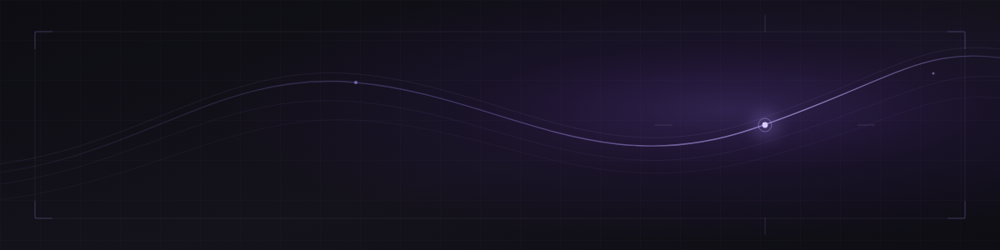

# Distracto

*I follow curiosities far enough to give them a shape: sometimes software, sometimes a prototype, sometimes a story.*

## About

Distracto is my personal developer identity and independent creative software studio: a place to build applications, explore unfamiliar technology, test ideas, and make room for creative work. Some explorations become useful tools; others are valuable because of what they teach along the way.

## Areas of interest

- Android development and Kotlin
- Artificial intelligence, local models, and personal assistants
- Python and practical software engineering
- Privacy-conscious applications
- Automation and small, useful tools
- Game development, interactive stories, and creative technology

## Philosophy

An unfinished project can still be worth the time. Experiments make questions concrete; prototypes help reveal what matters; documenting the process keeps the learning. I value the act of building as much as the finished result.

## Find me elsewhere

[ GitHub](https://github.com/iamdistracto) · [ YouTube](https://www.youtube.com/@iamdistracto) · [ X](https://x.com/iamdistracto)

YouTube is where I share animation, storytelling, and the personal side of Distracto.

